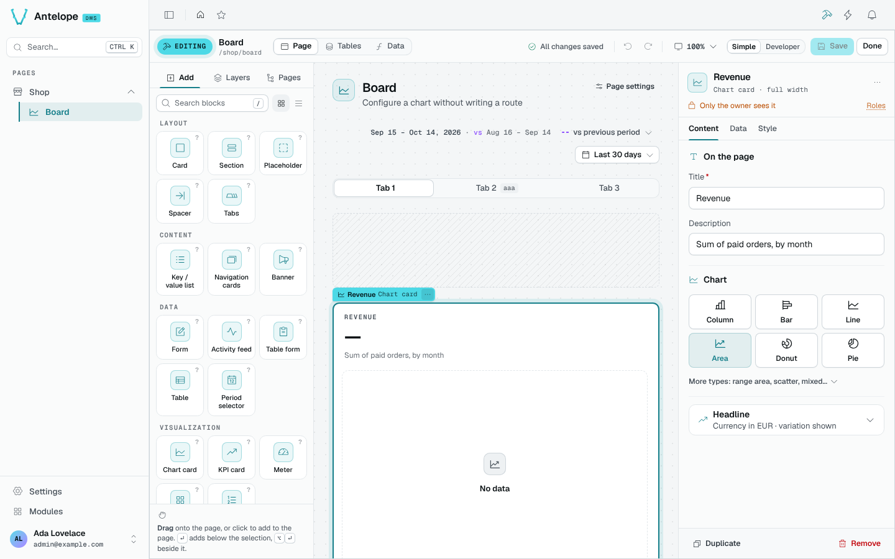

<div align="center">

# @antelopejs/dms-builder

<a href="https://www.npmjs.com/package/@antelopejs/dms-builder"></a>
<a href="./LICENSE"></a>
<a href="https://discord.gg/sjK28QHrA7"></a>
<a href="https://dms.antelopejs.com/docs/modules/builder"></a>

Visual and programmatic editing of an AntelopeJS DMS project's own source code.

</div>



## What it does

- Turns any DMS page into an editor (**Edit this page**, `Ctrl` `B`): add blocks from a catalog, arrange them, configure them and bind them to data.
- Writes each edit into the project's TypeScript as an AST rewrite, typechecks it in memory, and writes only if it compiles.
- Creates pages from a layout, arranges the menu, and generates tables with their fields and API.
- Gives a chart or a KPI its numbers from a query, without hand-writing a route.
- Exposes the same operations to other modules through [`@antelopejs/interface-dms-builder`](./packages/interface-dms-builder) and to agents through an HTTP API under `/api/builder`.

The builder runs in development only (`ajs project run`), and every route requires a tenant owner.

## Install

Run the AntelopeJS CLI from the root of a project that already loads `@antelopejs/dms`:

```bash
ajs project modules add @antelopejs/dms-builder
```

## Quick start

The builder edits the project it runs in. When the backend's working directory is not the app's source root, set `projectRoot`:

```ts
// antelope.config.ts
"dms-builder": {
  source: { type: "package", package: "@antelopejs/dms-builder", version: ">=0.4.0 <1.0.0" },
  config: {
    projectRoot: __dirname,
  },
},
```

Start the backend with `ajs project run -w`, then the frontend with `ajs dms dev`. Open any page and click **Edit this page**, or press `Ctrl` `B` (`⌘` `B` on macOS).

## Compatibility

| Package | Version |
| --- | --- |
| `@antelopejs/dms` | `>=0.9.0 <1.0.0` |
| `@antelopejs/interface-dms` | `>=0.7.0 <1.0.0` |
| `@antelopejs/dms-frontend` (renderer) | `>=0.6.0 <0.7.0` |
| `@antelopejs/interface-dms-builder` | `>=0.2.0 <0.3.0` |
| API provider | `@antelopejs/api`, for the HTTP routes |

On DMS 0.8, use `@antelopejs/dms-builder` 0.3.

## Packages

| Package | Directory | Role |
| --- | --- | --- |
| [`@antelopejs/dms-builder`](https://www.npmjs.com/package/@antelopejs/dms-builder) | [`packages/dms-builder`](./packages/dms-builder) | The module: the AST engine, the HTTP API and the builder UI. |
| [`@antelopejs/interface-dms-builder`](https://www.npmjs.com/package/@antelopejs/interface-dms-builder) | [`packages/interface-dms-builder`](./packages/interface-dms-builder) | The interface another module in the same process calls. |

## Documentation

- [Introduction](https://dms.antelopejs.com/docs/modules/builder/introduction)
- [Installation](https://dms.antelopejs.com/docs/modules/builder/installation)
- [Configuration](https://dms.antelopejs.com/docs/modules/builder/configuration)
- [Usage](https://dms.antelopejs.com/docs/modules/builder/usage/page-editor)
- [Extending](https://dms.antelopejs.com/docs/modules/builder/extending): the interface and the HTTP API
- [FAQ](https://dms.antelopejs.com/docs/modules/builder/faq)

The guide's sources live in [`packages/dms-builder/docs`](./packages/dms-builder/docs); the interface reference lives in [`packages/interface-dms-builder/docs`](./packages/interface-dms-builder/docs). The module ships the `dms-builder` Claude Code skill in [`packages/dms-builder/skills`](./packages/dms-builder/skills), declared under `antelopeJs.skills`.

## Contributing

Read [CONTRIBUTING.md](./CONTRIBUTING.md) before opening a pull request. One root `pnpm install` installs the shared tooling, both packages and the builder UI (`frontend-vue`). Workspace packages keep separate lockfiles to preserve their dependency resolutions. The playground remains independent.

```bash
pnpm install
pnpm build          # the interface, then the module
pnpm lint
pnpm typecheck
pnpm test
```

The playground (`packages/dms-builder/playground`) loads the builder with a demo `order` table and a **Board** page holding a chart to configure. From that directory, run `pnpm install --ignore-workspace`, then `pnpm dev` and `pnpm frontend:dev`.

<details>
<summary>Repository notes</summary>

- `frontend-vue/dms.frontend.ts` registers the `DmsBuilder` components and the client plugin at priority 100, only when the backend's manifest entry carries `dmsBuilder.enabled === true`. Check it with `pnpm --dir packages/dms-builder/frontend-vue typecheck` and `lint`.
- The module implements the interface, so it depends on it through `>=<interface version> <0.<minor + 1>.0`: a breaking interface minor never reaches a module that does not implement it. Inside the workspace pnpm resolves that range to the sibling package.
- Each package releases on its own: `release-interface.yml` publishes `@antelopejs/interface-dms-builder`, then `release.yml` publishes `@antelopejs/dms-builder` and refuses to run until the interface version its range is floored at is on npm.

</details>

## License

[Apache-2.0](./LICENSE)
