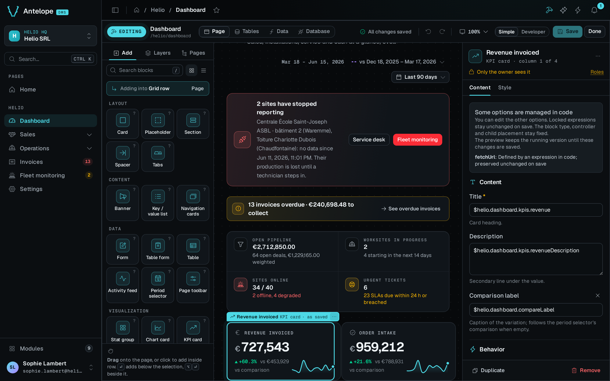

<div align="center">

# `@antelopejs/dms-builder`

<a href="https://www.npmjs.com/package/@antelopejs/dms-builder"></a>
<a href="./LICENSE"></a>
<a href="https://discord.gg/g4pFt6eXqu"></a>
<a href="https://dms.antelopejs.com/docs/modules/builder"></a>

**Edit the pages, tables and data sources of an AntelopeJS DMS project from the dashboard, as TypeScript that compiles.**

</div>



## What it does

- Turns any DMS page into an editor, opened with the hammer button in the page header or `Ctrl` `B`. In the editor you add blocks from a catalog, arrange them, configure them and bind them to data.
- Writes each edit into the project's TypeScript as an AST rewrite, typechecks it in memory, and writes only if it compiles.
- Creates pages from a layout, arranges the menu, and generates tables with their fields and API.
- Gives a chart or a KPI its numbers from a query, without hand-writing a route.
- Exposes the same operations to other modules through [`@antelopejs/interface-dms-builder`](https://github.com/AntelopeJS/dms-builder/tree/main/packages/interface-dms-builder) and to agents through an HTTP API under `/api/builder`.

By default the builder runs only in development (`ajs project dev`), and every route requires a tenant owner.

## Install

Run the AntelopeJS CLI from the root of a project that already loads `@antelopejs/dms`:

```bash
ajs project modules add @antelopejs/dms-builder
```

## Quick start

The builder edits the project it runs in. If the backend's working directory is not the app's source root, set `projectRoot` in the entry that `ajs project modules add` wrote:

```ts fragment
// antelope.config.ts
"@antelopejs/dms-builder": {
  source: { /* … */ },
  config: {
    projectRoot: __dirname,
  },
},
```

Start the backend with `ajs project dev -w`, then the frontend with `ajs dms dev`. Open any page and click the hammer button in the page header, or press `Ctrl` `B` (`⌘` `B` on macOS).

## Compatibility

<!-- antelopejs-docs-compat:start -->

| Package                                  | Supported         | Tested with |
| ---------------------------------------- | ----------------- | ----------- |
| `@antelopejs/interface-api`              | `>=0.3.0 <1.0.0`  | `0.3.0`     |
| `@antelopejs/interface-core`             | `>=0.4.0 <1.0.0`  | `0.4.0`     |
| `@antelopejs/interface-database`         | `>=0.3.0 <1.0.0`  | `0.3.0`     |
| `@antelopejs/interface-database-catalog` | `>=0.0.3 <1.0.0`  | `0.0.3`     |
| `@antelopejs/interface-dms`              | `>=0.12.0 <1.0.0` | `0.12.0`    |
| `@antelopejs/interface-dms-builder`      | `>=0.4.0 <0.5.0`  | `0.4.0`     |

<!-- antelopejs-docs-compat:end -->

The module needs a DMS backend that implements the `@antelopejs/interface-dms` range in the table above. Its frontend needs a `@antelopejs/dms-frontend` renderer in the range of `engines["@antelopejs/dms-frontend"]` in `frontend-vue/package.json`. The `ajs dms` CLI refuses to build the frontend with a renderer outside that range.

The HTTP routes need an API provider, such as `@antelopejs/api`.

## Documentation

- [Introduction](https://dms.antelopejs.com/docs/modules/builder/introduction)
- [Installation](https://dms.antelopejs.com/docs/modules/builder/installation)
- [Configuration](https://dms.antelopejs.com/docs/modules/builder/configuration)
- [Usage](https://dms.antelopejs.com/docs/modules/builder/usage/page-editor)
- [Extending](https://dms.antelopejs.com/docs/modules/builder/extending): the interface and the HTTP API
- [FAQ](https://dms.antelopejs.com/docs/modules/builder/faq)

The runtime guide and the HTTP API documentation live in [`docs/`](./docs). The canonical reference for the contract that consumers import lives in [`packages/interface-dms-builder/docs`](../interface-dms-builder/docs/1.introduction.md). The module ships the `dms-builder` Claude Code skill in [`packages/dms-builder/skills`](https://github.com/AntelopeJS/dms-builder/tree/main/packages/dms-builder/skills), declared under `antelopeJs.skills`.

## Contributing

This package lives in the [`AntelopeJS/dms-builder`](https://github.com/AntelopeJS/dms-builder) pnpm workspace, next to `@antelopejs/interface-dms-builder`. Read [CONTRIBUTING.md](https://github.com/AntelopeJS/dms-builder/blob/main/CONTRIBUTING.md) and the [repository README](https://github.com/AntelopeJS/dms-builder#contributing) for the development commands.

## License

[Apache-2.0](./LICENSE)
