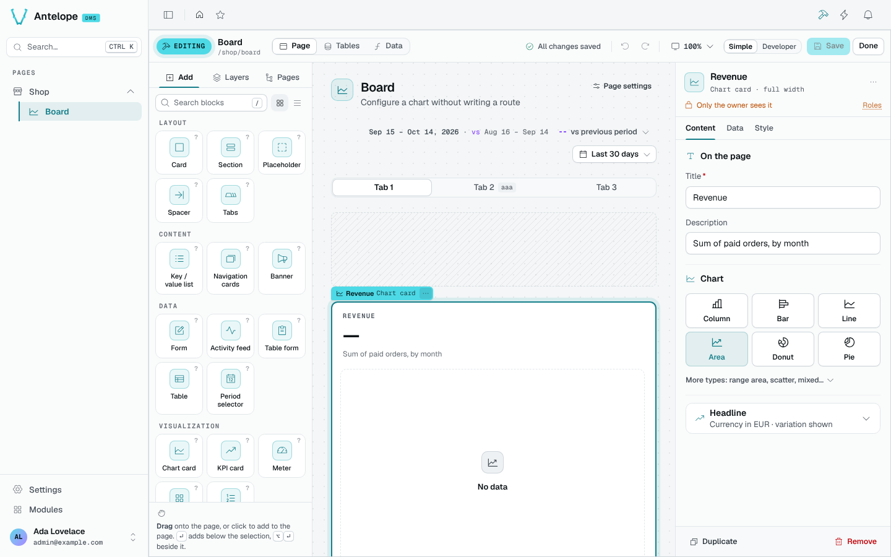

`@antelopejs/dms-builder` turns any DMS page into an editor. The hammer button in the page header, or `Ctrl` `B`, turns the page you are looking at into a canvas.

When you add a card, change its title and save, the page updates and the matching TypeScript changes appear in your project. You can then connect the card to data or arrange it next to other blocks.

## What one change looks like

Once the builder is [installed](/docs/modules/builder/installation), a tenant owner can open an existing page and click the hammer button. Selecting a card opens its settings, and its title sits in **Content**. The canvas then shows a draft, not a saved page. The count of unsaved changes in the editor bar opens the change list, where **Save** writes the edit. **Done** leaves the editor, and the page shows the new title. The source diff is ready to review before you commit it.

Edits in **Tables** and in the menu save at once. Discarding a page draft does not undo them, so a first edit that only touches a page leaves them alone.

## What it brings

::card-group
  :::card{title="Page editor" icon="i-lucide-layout-dashboard" to="/docs/modules/builder/usage/page-editor"}
  The catalog, the layers, the live canvas and the inspector, with undo, redo and a draft kept on your device.
  :::

  :::card{title="Pages and menu" icon="i-lucide-folder-tree" to="/docs/modules/builder/usage/pages"}
  Create pages from a layout, arrange the menu and its categories.
  :::

  :::card{title="Tables" icon="i-lucide-table" to="/docs/modules/builder/usage/tables"}
  Create tables with their fields and API, and see which pages read them.
  :::

  :::card{title="Data sources" icon="i-lucide-function-square" to="/docs/modules/builder/usage/data-sources"}
  Give a chart or a KPI its numbers without writing a route.
  :::

  :::card{title="Save, review and access" icon="i-lucide-shield-check" to="/docs/modules/builder/usage/saving-and-access"}
  The change list, the checks run on save, and who sees each block.
  :::
::

## How it works

The builder keeps no database of pages. It reads these structures from your sources:

| Structure | Source representation |
| --- | --- |
| Page | A `PageController` class |
| Block | One of the page's static fields or a `.child()` of another block |
| Table | A `Table`, a `DataController` and a model |

For each edit, the builder runs these steps:

1. It parses those files.
2. It applies the edit as an AST rewrite.
3. It typechecks the whole project in memory.
4. It writes the files only when the result compiles.

Hand-written code and builder-written code are the same code, so you can keep editing a page either way.

The builder has two kinds of client:

- the builder UI in the dashboard, which these pages describe,
- other modules and agents, through the [`@antelopejs/interface-dms-builder`](https://github.com/AntelopeJS/dms-builder/tree/main/packages/interface-dms-builder/docs) interface and an HTTP API under `/api/builder`. [Extending](/docs/modules/builder/extending) covers both.

::important
The builder rewrites source files, so by default it is on only in development (`ajs project dev`, with or without `-w`). A started build (`ajs project start`) has no builder routes and no builder button unless [`api.enabled`](/docs/modules/builder/configuration) forces them on.
::

## Who can use it

Every builder route requires an authenticated tenant owner.

## Works with the AI assistant

When [`@antelopejs/dms-ai`](/docs/modules/ai/introduction) is loaded with the builder, the assistant edits pages through the same operations. In **Safe mode**, its default, it changes the project only through the builder, so the builder typechecks every change and you can undo it.
