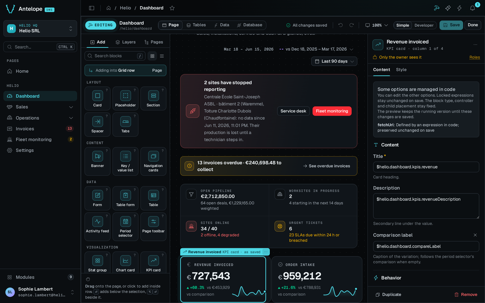

You need a working DMS project and a tenant-owner account. When you finish, the builder button opens a canvas with a block catalog on the left and settings on the right.

::steps
### Add the module

```bash [Terminal]
ajs project modules add @antelopejs/dms-builder
```

The module needs a module that implements `@antelopejs/interface-api` for its HTTP routes, and the database and DMS interfaces the project already uses. The [README compatibility table](https://github.com/AntelopeJS/dms-builder/tree/main/packages/dms-builder#compatibility) lists the interface ranges it supports. Its frontend needs a `@antelopejs/dms-frontend` renderer in the range of `engines["@antelopejs/dms-frontend"]` in `frontend-vue/package.json`.

### Point it at your sources

The builder edits the project it runs in. If the backend's working directory is not the app's source root, set `projectRoot` in the entry that `ajs project modules add` wrote:

```ts fragment [antelope.config.ts]
"@antelopejs/dms-builder": {
  source: { /* … */ },
  config: {
    projectRoot: __dirname,
  },
},
```

### Run the project in development

Start the backend from the project directory:

```bash [Terminal 1, backend]
pnpm exec ajs project dev -w
```

When the backend has started, start the frontend in a second terminal:

```bash [Terminal 2, frontend]
pnpm exec ajs dms dev
```

The backend registers the builder's frontend module only when the builder is on, so the frontend must start after it.

### Open the editor

Open any DMS page. Click the hammer button in the page header, or press `Ctrl` `B` (`⌘` `B` on macOS).
::



To check the preview, select a card and change its title. Save to write the change, or discard the page draft to leave the source untouched. If the button is missing, read [the FAQ](/docs/modules/builder/faq#the-hammer-button-is-missing) before you turn the builder on in a production process.

::tip
The repository's playground (`packages/dms-builder/playground`) loads the builder with a demo `orders` table and a **Board** page that holds a chart to configure. In that directory, run `pnpm install --ignore-workspace`, then `pnpm dev` and `pnpm frontend:dev`.
::
