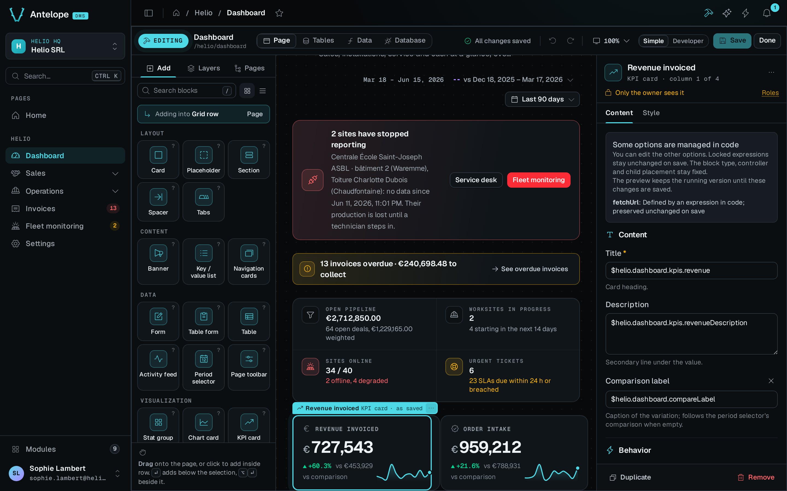
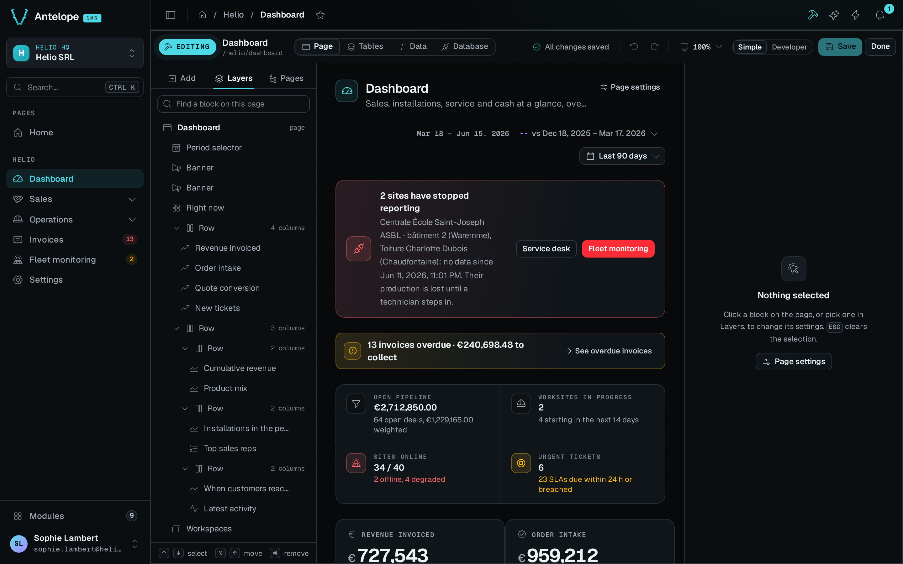

The builder opens on the page you are looking at. Click the hammer icon in the header, or press `Ctrl` `B` (`Cmd` `B` on macOS). The editor sits over the page's content, and the sidebar, header and breadcrumb stay usable behind it. The same icon and the same keys close it.

## Bar

The bar across the top holds, from left to right:

- The **Editing** badge, then the page's title and address.
- The workspaces. They are **Page**, [**Tables**](/docs/modules/builder/usage/tables), [**Data**](/docs/modules/builder/usage/data-sources) and **Database**, the last for connecting an existing database and mapping its tables.
- The save status, which opens the [change list](/docs/modules/builder/usage/saving-and-access).
- **Undo** and **Redo**.
- The **View as** menu, an eye icon, shown only when the workspace has roles and roles decide who sees the page. A page every member reaches without a role, or a page no role is asked about, such as a module's page, has none.
- The canvas zoom and width (**Desktop**, **Tablet** or **Phone**).
- The **Simple** or **Developer** switch.
- **Save** and **Done**.

The save status reads one of **All changes saved**, **Saved** with the time, *n* **unsaved changes**, **Checking & saving…**, *n* **to fix**, or **Save failed · nothing written**.

**Simple** mode lists the blocks a page author needs in the catalog. **Developer** mode adds the others, such as `CodeBlock`, `EmptyState`, `LiveToggle` and the blocks the DMS does not describe. It also shows each block's name next to its title.

## Add tab

The **Add** tab lists the catalog by group (**Layout**, **Content**, **Data**, **Visualization** and **Other**), as tiles or as a list. A search field, **Search blocks**, sits on top and also matches a block's description. A block the selected container refuses stays listed, grey, with the reason in its tooltip.

To place a block, drag it onto the page or click it to add it to the container you are working in. In the search field, `Enter` adds the first allowed result below the selected block and `Alt` `Enter` adds it beside it.

A drop aims at a block already on the page. The pointer picks the nearest of that block's edges. The left and right edges put the new block in a column before or after it. The top and bottom edges put it above or below. A container also has a middle that puts the new block inside it, and only a band along its edges, at most 32 pixels deep, aims beside it. Before you let go, the canvas names where the block would land, such as **Beside Revenue · new column**. The editor writes the rows and columns a drop needs, so you never place a grid yourself.

## Layers tab

The **Layers** tab shows every block of the page as a tree, with **Find a block on this page** above it. Click a row to select its block. The **…** button on a row opens the block's menu. A warning icon marks a block with a required setting still empty.

## Pages tab

The **Pages** tab shows the menu. See [Pages and menu](/docs/modules/builder/usage/pages).

## Canvas

The canvas renders the page with its real components. Its layout comes from a server-side preview of your draft, so a card fetches its real data and a grid lays itself out as it will once saved. A table shows its columns and rows read-only. A block the preview cannot build, such as a table the running app has not loaded yet, shows as a labelled stand-in.

## Inspector

The inspector shows the selected block: its title, its kind and its place in words, such as *column 2 of 3* or *full width*. Under the heading, a line says who sees the block, with a link to **Roles**.

The settings sit in tabs. Most blocks have **Content**, **Data** and **Style**, each shown once it holds a setting. A table has **Content**, **Actions** and **Style**. A form has **Fields**, **After submit** and **Style**. A chart card, a KPI card and a top list have **Content**, **Data** and **Style**.

Blocks with a panel of their own are set up in plain words. Every other block gets a panel generated from its schema, also in words. A size reads *S*, *M* or *L*, a tone shows in its color, and a link to another page offers the project's pages by name. **Duplicate** and **Remove** sit at the bottom. The **…** button in the heading opens the block's menu.

With nothing selected, the inspector says **Nothing selected** and offers a **Page settings** button.

## Controls the editor places for you

The editor adds some blocks itself when a setting needs them.

- A period selector and a Live / Pause switch go into the page's **Page toolbar**. The toolbar is the bar at the top of the page body that shows when the page last read its data. The editor uses the toolbar the page has, or puts one at the top. A toolbar written in code is left alone. On a page that has its period selector or its Live / Pause switch on its own at the top level, the new control goes next to it. See the [Page toolbar reference](/docs/components/layout-and-containers/page-toolbar).
- Binding a card to the page's period adds a period selector to the toolbar when nothing on the page sets the period yet. It does so once, in the edit that binds the card. A selector you remove stays removed. The selector takes the settings that `pageToolbar()` of the DMS gives it, read from the DMS catalog. Its presets are 1H, 24H, 7D and 30D, on the last 24 hours by default. Its comparison menu starts on the previous period. See the [Period selector preview](/docs/components/charts-and-widgets/period-selector) for the control and its ranges.
- Turning on the page's **Live updates** setting adds a Live / Pause switch. Turning it off removes the switch, and the toolbar too when the switch was all it held. See the [Live toggle reference](/docs/components/charts-and-widgets/live-toggle).
- A **Page toolbar** added from the catalog goes to the top of the page. It comes with a period selector when nothing on the page sets the period, and a Live / Pause switch when the page is live. The **Dashboard** starting layout begins with one.
- A meter, a Live / Pause switch or a period selector placed in a section gets a row of that section around it, with its label and help text.
- A card, a section or a tab of a tab set can show one message instead of its content when a source says there is nothing to show. Its setting is **Show a message when there's nothing to show**, and the editor writes the `Guard` block for it.

## Keyboard

`Ctrl` and `Cmd` work the same in every shortcut.

| Key | Action |
| --- | --- |
| `Ctrl` `B` | Open or close the builder |
| `Ctrl` `S` | Save |
| `Ctrl` `Z` | Undo |
| `Ctrl` `Shift` `Z` | Redo |
| `Ctrl` `D` | Duplicate the selected block |
| `Delete` or `Backspace` | Remove the selected block |
| `↑` or `↓` | Select the previous or next block, or the last or first one when nothing is selected |
| `Alt` `↑` or `Alt` `↓` | Move the selected block |
| `Enter` | Open the selected block's settings |
| `/` | Search the catalog |
| `Esc` | Close the block menu, then clear the selection. It never closes the builder. |

`Ctrl` `S` works anywhere, text fields included. `Ctrl` `B` works anywhere except inside editable text. The other shortcuts do nothing while you type in a field. The keys that act on the selected block (the arrows, `Ctrl` `D`, `Delete`, `Backspace` and `Enter`) work only in the **Page** workspace. Outside a block, they do nothing while the focus is on a field, a button, a menu or a switch, a row of **Layers** included. Inside a block on the canvas, they act on the block.
