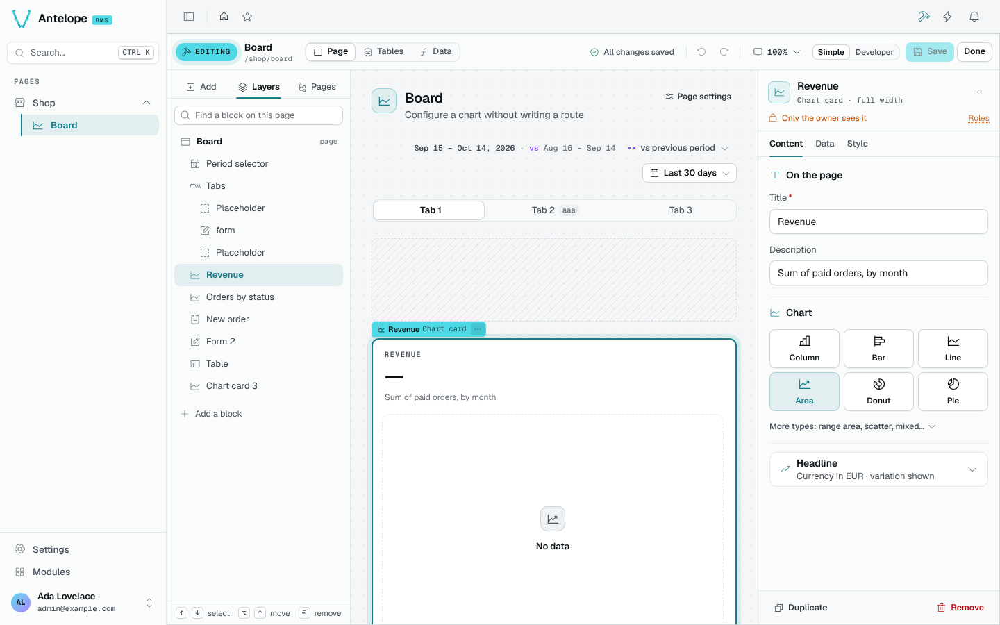

# Page editor

Open any page and click the hammer icon in the header (**Builder — edit this page**), or press `Ctrl` `B`. The builder is a mode of the page you are looking at, laid over its content: the sidebar, header and breadcrumb stay usable behind it.

## Bar

The bar shows the mode, the page and its address, and three workspaces: **Page**, [**Tables**](/docs/modules/builder/usage/tables) and [**Data**](/docs/modules/builder/usage/data-sources). Then the save status (saved, *n* unsaved changes, saving, to fix, failed), which opens the [change list](/docs/modules/builder/usage/saving-and-access), undo and redo, the canvas zoom and width, **Simple** or **Developer** mode, **Save** and **Done**.

**Simple** mode keeps the catalog to the blocks a page author needs; **Developer** mode adds the rest, such as a block of source code.

## Add blocks

The **Add** tab lists the catalog, grouped by purpose (Layout, Content, Data, Visualization…), as searchable tiles or a list. Drag a block onto the page, or click it to add it near the selection. In the catalog search, `Enter` adds the first allowed result below the selection and `Alt` `Enter` adds it beside the selection. On the canvas, `Enter` opens the selected block's settings instead.

A drop is aimed at a block that is already there. Each block of a grid answers on its four sides: its left and right quarters place the new block in the column before or after it, the bands across its top and bottom above or below it, and the middle of a container inside it. Where it would land is said in words before you let go. The rows and columns this needs are written by the editor: you never place a grid by hand.

## Layers

The **Layers** tab shows every block of the page as a tree. Click a row to select the block; `↑` and `↓` select the block before or after, `Alt` `↑` / `Alt` `↓` move it, `Delete` removes it.

## Canvas

The canvas renders the page with its real components. Its layout comes from a server-side preview of your draft, so a card fetches its real data and a grid lays itself out exactly as it will once saved. A table shows its columns and rows read-only. A block the preview cannot build faithfully, such as a table the running app has not loaded yet, shows as a labelled stand-in.

## Inspector

The inspector shows the selected block, named as the page shows it and placed in words (*Top list · column 2 of 3*), and **who sees it**. Its settings sit in tabs: **Content**, **Data**, **Style**, plus **Actions** for a table and **Fields** and **After submit** for a form.

Blocks with a panel of their own are set up in plain words; the others get a panel generated from their schema, still in words: a size reads *S / M / L*, a tone is drawn in its colour, a link to another page is picked among the pages by name. **Duplicate** (`Ctrl` `D`) and **Remove** sit at the bottom. With nothing selected, the inspector offers the page's own settings.

## Controls the editor places for you

- Both controls below go into the page's **Page toolbar**, the bar at the top of the page body that shows when the page last read its data, its Live / Pause switch and its period, at one size. The editor uses the toolbar the page already has, or puts one at the top. A page whose period selector or Live / Pause switch already sits on its own at the top level gets the new control beside it instead, as does a toolbar written in code. See the [Page toolbar reference](/docs/components/layout-and-containers/page-toolbar).
- Binding a card to the page's period puts a period selector in the toolbar of a page that has none (once: one you remove stays removed). In the toolbar it is set as the DMS's `pageToolbar()` sets it (the editor reads those settings from the DMS): presets 1H / 24H / 7D / 30D, last 24 hours by default, a comparison menu. See the [Period selector preview](/docs/components/charts-and-widgets/period-selector) for the control and its date-range choices.
- The page's **Live updates** setting adds its Live / Pause switch. Turning it off removes the switch, and the toolbar too when the switch was all it held. The [Live toggle reference](/docs/components/charts-and-widgets/live-toggle) shows the control on a live page; it is not a capture of the builder setting.
- A **Page toolbar** placed from the palette goes to the top of the page, with a period selector when nothing on the page sets its period yet and a Live / Pause switch when the page is live. The **Dashboard** starting layout begins with one.
- A meter, a switch or a period picker placed in a section gets the section's row around it, with its label and help text.
- A card, a section or a tab can show one message instead of its content when a source says there is nothing to show; the editor writes the `Guard` block for it.

## Keyboard

| Key | Action |
| --- | --- |
| `Ctrl` `B` | Open or close the builder |
| `Ctrl` `S` | Save |
| `Ctrl` `Z` / `Ctrl` `Shift` `Z` | Undo / redo |
| `Ctrl` `D` | Duplicate the block |
| `Delete` | Remove the block |
| `↑` / `↓` | Select the previous / next block |
| `Alt` `↑` / `Alt` `↓` | Move the block |
| `Enter` | Open the block's settings |
| `/` | Search the catalog |
| `Esc` | Close the block menu, then deselect (it never leaves the editor) |

Shortcuts apply while the focus is on the page, not on a field of the panel.
