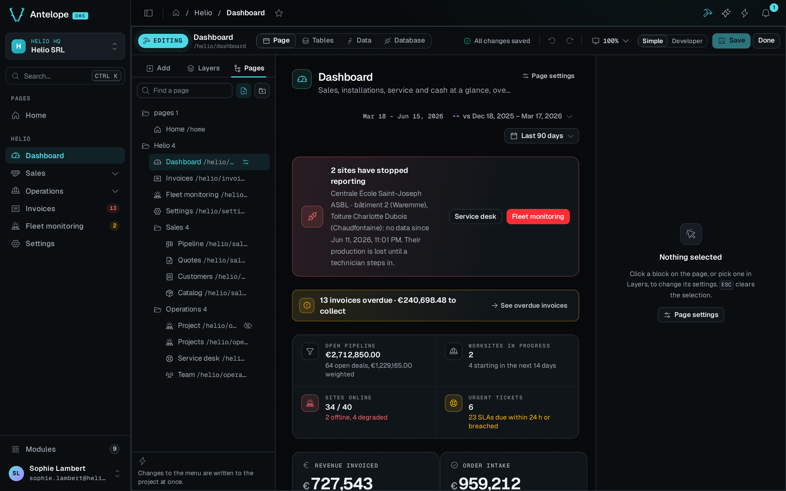
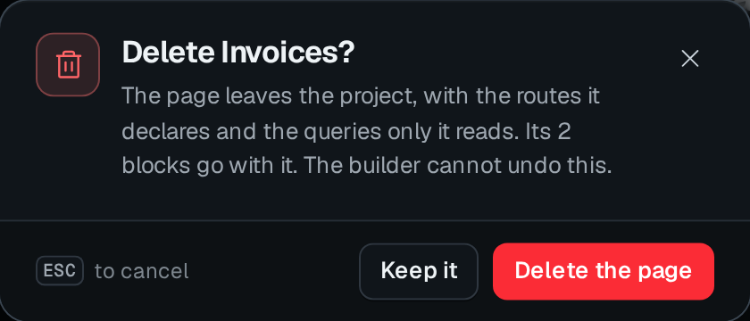

The **Pages** tab of the side rail shows the menu, with its categories and pages in order. Each category shows how many pages it holds, or *empty*.

::note
Menu changes write to the project at once, for every page that reads the menu. They are creating or deleting a page, moving a page to another category, and creating, renaming, reordering or deleting a category. **Save** and **Discard** do not touch them. The change list notes each one under **Already written**. A page's title, its **Position** and its **Show in the menu** switch belong to the page's draft and wait for **Save**.
::

## Create a page

1. In **Pages**, click **New page**, or the **New page in** button of a category.
2. Type the **Title**. The **Address** follows the title. Click **Edit** to change it. The address also names the page's folder and its exported class.
3. Choose the **Category** and, if you want, write a **Description**.
4. Under **Start from**, pick **Blank**, **Dashboard**, **List** or **Form**.
5. Click **Create page**.

The builder checks the address as you type. If another page already answers at it, the field says so and **Create page** stays disabled. The new page opens once the app has reloaded.

## Create a category

1. In **Pages**, click **New category**.
2. Type the **Title**, and pick a **Parent category** or leave it at **Top level**.
3. Click **Create category**.

To rename a category, click its **Rename** button. To delete it, click **Delete the empty category**, which shows only on a category with nothing in it.

## Reorder the menu

- To move a category, click its up or down arrow. The move is written at once.
- To move the open page among its siblings, set **Position** in its page settings. The position is saved with the page.
- To move the open page to another category, pick its **Category** in the page settings. The move is written at once.

The settings icon on the open page's row opens its page settings in the inspector. They hold the title, the icon, the description, **Show in the menu**, **Position**, **Live updates**, the **Category**, and **Who can see it**.

## Delete a page

1. Click the page's trash icon in **Pages**, or **Delete the page** at the bottom of its page settings.
2. Read the confirmation. It says the page leaves the project with the routes it declares and the queries only it reads. It counts the page's blocks and data sources, and names the pages that still link to it. If the open page has unsaved changes, it says they go too.
3. Click **Delete the page** to delete it, or **Keep it** to cancel.

The deletion is written at once, and the builder cannot undo it.
