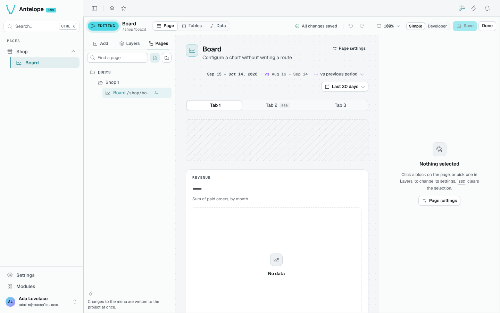

# Pages and menu

The **Pages** tab of the side rail shows the menu: categories and pages, in their order.

- **New page** starts a page from a layout. Its address is checked as you type.
- **New category** adds a folder to the menu.
- Drag pages and categories to reorder them; the settings icon of a page opens its settings (title, description, icon, address, access, visibility).

::note
Changes to the menu are written to the project at once, for every page reading them, unlike block edits, which wait for **Save**. The change list keeps a note of each one.
::

## Delete a page

Before deleting a page, the builder lists what goes with it: its blocks, its data sources, and the pages linking to it.
