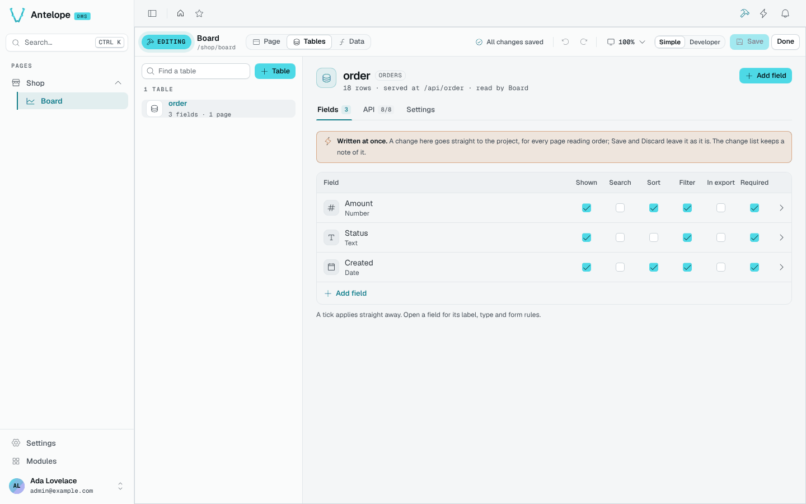
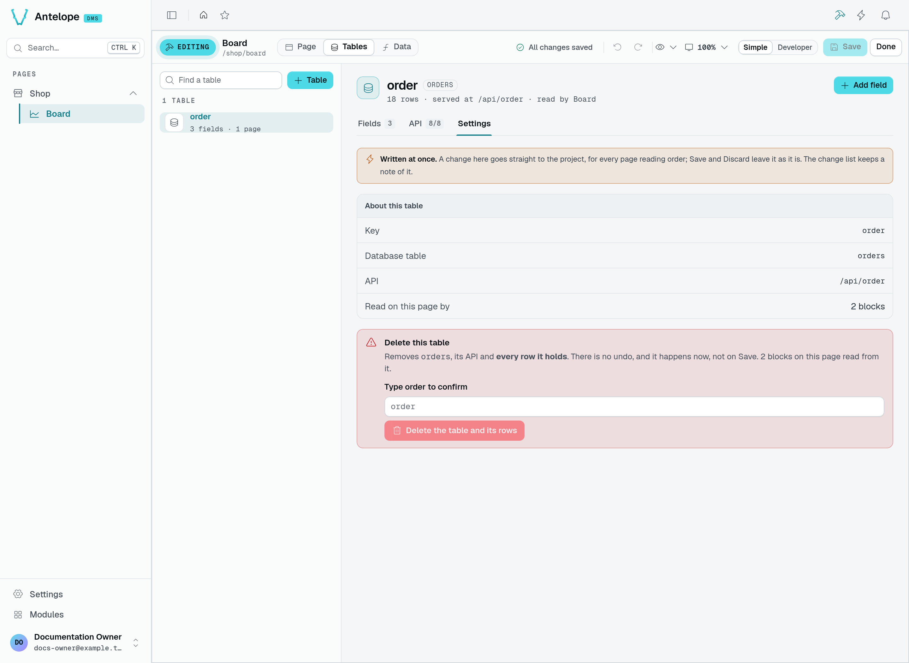

# Tables

The **Tables** workspace lists the project's tables, each with its number of fields and the pages reading it (or *unused*). **+ Table** creates one: a `Table`, a `DataController` and a model, written into a wired folder.

A table opens on three tabs:

- **Fields**: each field with its type and ticks for **Shown**, **Search**, **Sort**, **Filter**, **In export** and **Required**. Open a field for its label, type and form rules; **Add field** adds one.
- **API**: the routes the table serves (list, get, create, edit, delete…), each on or off.
- **Settings**: what the table is (its key, database table, API route and the blocks of this page reading it) and **Delete this table**, which removes the table, its API and every row it holds at once, once you type its key to confirm.

The header says how many rows the table holds at your tenant, where its API is served, and which pages read it.

::warning
A table is shared by every page reading it, so its changes are **written at once**: Save and Discard leave them as they are. The change list keeps a note of each one, with the pages it reached.
::

## Review a table deletion

Open the table's **Settings** tab to see the deletion control alongside its key, database table and API route.

This capture stops before deletion: the field is empty, and `order` is its placeholder. Type the table key to enable **Delete the table and its rows**. Clicking that button deletes immediately; it does not create a draft waiting for **Save**. Leave the field empty and switch tabs if you only want to inspect the table.
