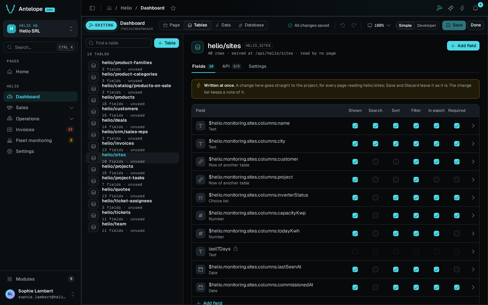
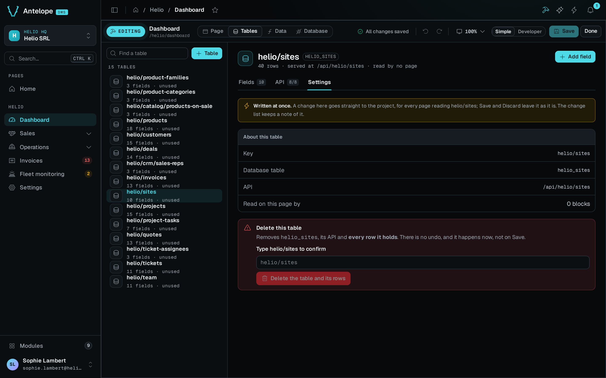

The **Tables** workspace lists the project's tables. Each line shows the table's number of fields and the number of pages that read it, or *unused*.

## Create a table

**+ Table** opens the **New table** form. The **Name** names the table and its API, and cannot be changed afterwards. The table starts with one field, **Title**. **Create table** writes a folder named after the table, with `database.ts`, `data-api.ts` and `index.ts`, and exports it from the nearest barrel. The files hold the table's `Table` class, its model and its `DataController`.

## Table header

The header of an open table shows how many rows the table holds at your tenant, the route its API is served at, and the pages that read it.

## Table tabs

A table opens on three tabs.

- **Fields** lists each field with its type and a tick for **Shown**, **Search**, **Sort**, **Filter**, **In export** and **Required**. Open a field to set its **Label**, its **Type**, **Required**, the operations the API also checks it on (**Create**, **Update**), and **In option lists** and **In export**. **Remove field** removes it. **Add field** adds one.
- **API** lists the routes the table can serve, as **Read** routes (**List**, **Read**, **Option lists**, **Export**) and **Write** routes (**Create**, **Update**, **Delete**, **Archive**). Each one is on or off. The last route served cannot be switched off.
- **Settings** shows the table's **Key**, its **Database table**, its **API** route and the blocks of this page that read it. Below them sits **Delete this table**.

::warning
Every page that reads a table shares it, so table changes are written at once. **Save** and **Discard** do not touch them. The change list notes each one under **Already written**, labelled with the table it changed, or with *tables* for a table created or deleted.
::

## Delete a table

**Delete this table** on the **Settings** tab removes the database table, its API, and every row it holds. The deletion happens at once, not on **Save**, and cannot be undone.

The confirmation field is labelled **Type** *key* **to confirm**, and shows the table's key as its placeholder. **Delete the table and its rows** stays disabled until the field holds the key. Clicking the button, or pressing `Enter` in the field once it holds the key, deletes the table.

The builder refuses to delete a table that another table's files import. A table that mirrors a database connected in the **Database** workspace loses its files, and its rows stay in that database.
