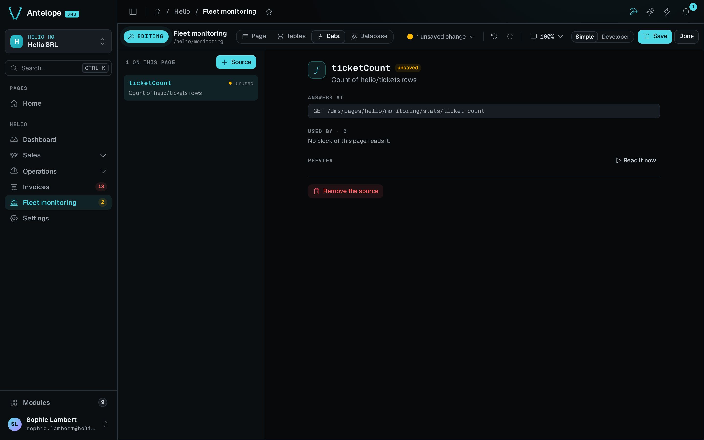

A chart card, a KPI card or a top list needs a route that answers its numbers. The builder writes that route from a description of the data: a table, a measure, a grouping, conditions, and the page's period. It generates the model method and the page route. The route checks the page's own permission with `@AuthUserWithPermission`.

The DMS serves a page's routes under its own prefix, `/dms/pages<page path>`. A source of the `/shop/board` page answers at `/dms/pages/shop/board/stats/<name>`, and that address is the `fetchUrl` the block reads.

## From a block

The **Data** tab of a chart card, a KPI card or a top list holds its source. **Table it measures** picks the table. The measure, the measured column and **Grouped by…** say what to show. **Sort**, **Top groups**, **Conditions** and **Period** refine it. **Period** binds the source to the page's period, so the block follows the period selector. The choices made for one source count as one undo step.

## The data workspace

The **Data** workspace lists the sources of the page, *n* **on this page**, each read as a sentence such as *Count of order rows, by Status*. A source not saved yet carries an *unsaved* badge. The open source shows these sections:

- **Answers at** gives the route the builder wrote, as `GET` and its path.
- **Used by** lists the blocks that read the source, each with **Select** to select it on the page.
- **Preview** has **Read it now**, which runs the source and shows its rows.
- **Remove the source** removes it. The button stays disabled while a block reads the source, or when the page's code wrote it.

**+ Source** adds a source without a block.

::tip
**Save** writes the sources in the same transaction as the page's blocks. **Discard** leaves no route behind that no block reads.
::
