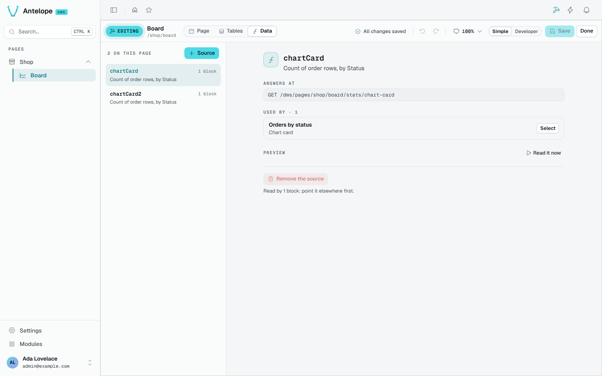

# Data sources

A chart or a KPI needs a route that answers its numbers. The builder writes that route for you: describe the data (a table, a measure, a grouping, filters, the page's period) and it generates the model method and the page route, guarded like the page. The DMS serves a page's routes under its own prefix, `/dms/pages<page path>`: a source of the `/shop/board` page answers at `/dms/pages/shop/board/stats/<name>`, and that is the `fetchUrl` the block reads.

## From a block

Select a chart card, a KPI card or a top list, and open its **Data** tab. Pick the table and say what to show; the choices of one source count as one undo step. Bind it to the page's period to make it follow the period selector.

## The Data workspace

The **Data** workspace lists the sources of the page, each read as a sentence (*Count of order rows, by Status*), with:

- **Answers at**: the route the builder wrote;
- **Used by**: the blocks reading it, with **Select** to jump to one;
- **Preview**: **Read it now** runs it;
- **Remove the source**, once no block reads it.

**+ Source** adds one without a block.

::tip
Sources are saved in the same transaction as the page's blocks: **Discard** leaves no orphan route behind.
::
