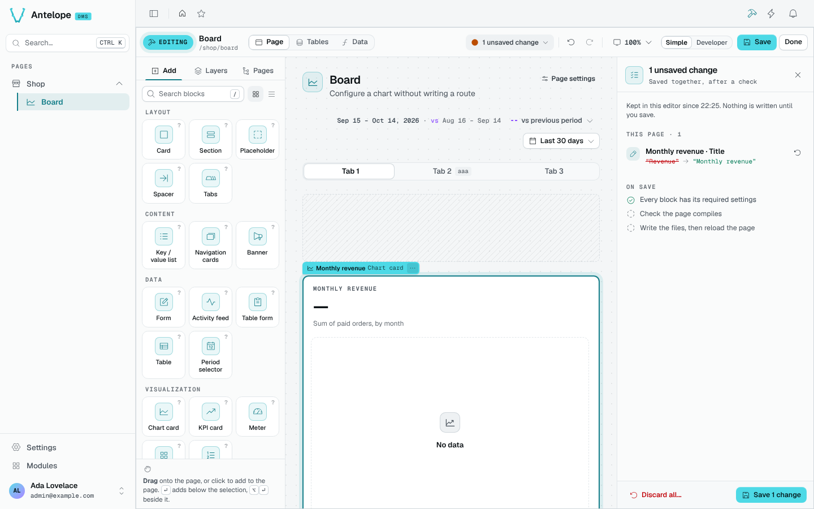
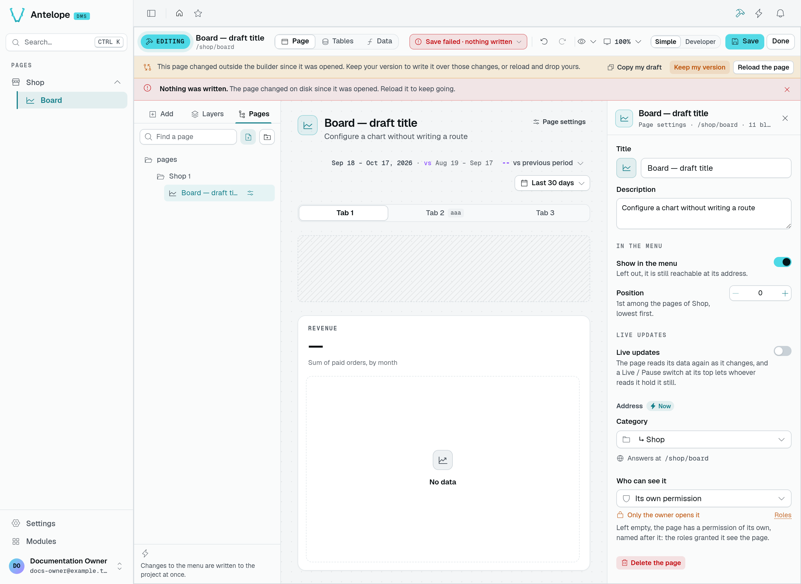
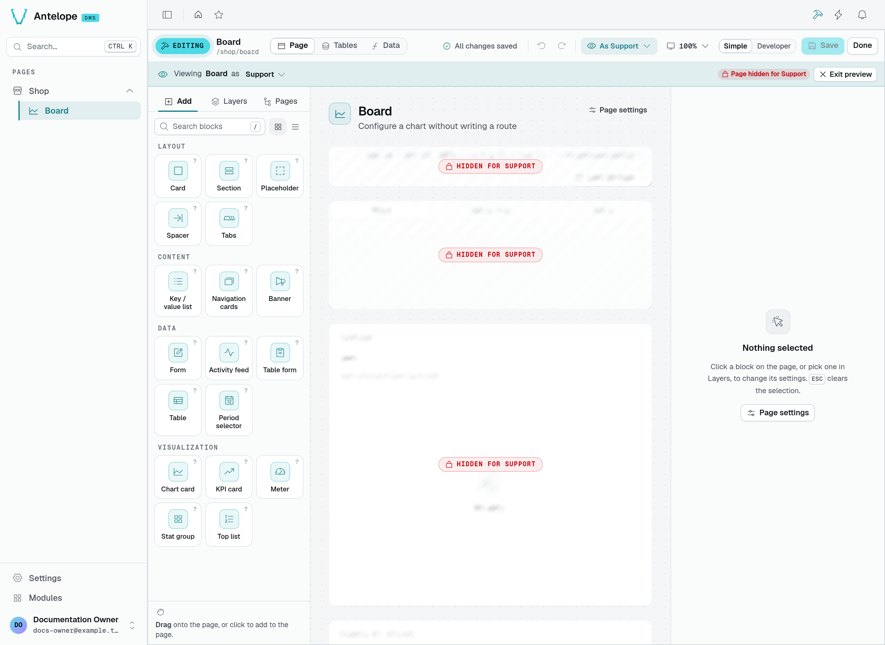

# Save, review and access

## The draft

Page blocks, their data sources and page settings stay in a local draft until you save. Undo and redo cover those edits; **Discard** drops them. The draft is kept on this device for a week and offered again on your next visit.

Menu, category and table edits are different: they are written immediately. **Discard** does not undo them. Check which workspace you are editing before trying a change you intend to throw away.

## The change list

Click the save status in the bar (*1 unsaved change*) to open the change list.

It lists:

1. every unsaved edit of the page, in plain words, each revertible on its own;
2. **On save**, what Save checks and writes: every block has its required settings, the page compiles, then the files are written and the page reloads;
3. what was already written straight to the project (tables, menu, categories), with what it reached.

**Save** writes the whole page in one transaction with one typecheck, its position, access and visibility included.

## When the source changed

If the page changed on disk while you were editing (another editor, an agent, a hand edit), the write is refused and the builder offers to keep your version or reload.

Here the title was edited in the builder while the description changed on disk. **Save** left the source untouched. **Copy my draft** preserves a copy before you decide; **Reload the page** drops your draft and loads the current source. **Keep my version** keeps the draft and accepts the current source version as its base; you must click **Save** again to write over those external changes.

## Who sees what

The DMS gives each block a permission of its own, named after where it sits: the page, then every block down to it, including the rows and columns the editor writes. Roles hold permission ids, not prefixes. Adding, renaming or moving a block therefore hands it a permission no role holds yet.

The [Roles editor capture](/docs/auth-and-tenancy/auth-and-permissions) shows where an administrator grants those permissions. It shows an unsaved role with no grants selected, not the builder's **View as** preview or a verified restricted session.

The builder makes this visible before you save:

- the change list warns (*Support loses Revenue*, *No role sees Notes yet*);
- the inspector says who sees the selected block (*Only the owner sees it*) and links to **Roles**;
- **View as** in the bar shows the draft as a role sees it: a block hidden from it is hatched, one whose actions it lacks is marked *Read only* or *Limited*.

Choose a role from the eye menu in the bar. In this playground capture, **Support** is a saved role with no grants: the preview marks the page and its blocks as hidden. **Exit preview** returns to your own view. You are still signed in as the owner; this is an editing preview, not a sign-in as that role or proof that a backend request was denied. Check protected routes separately when testing authorization.
