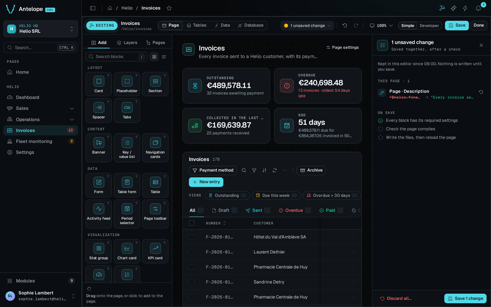

## The draft

The draft holds a page's blocks, their data sources and the page's settings until you save. **Undo** and **Redo** cover those edits. **Discard all…** in the change list drops them after a confirmation, and **Undo** brings them back while the editor stays open.

The draft is kept in the browser's local storage on this device for seven days. When you open the page in the builder again, the builder puts the draft back and says so, with **Review** and **Discard**. If the page changed since, it asks first, because putting the draft back undoes what changed. **Put them back** restores it anyway.

Leaving the builder with unsaved changes, by **Done**, the hammer icon or `Ctrl` `B`, asks **Save before leaving?**, with **Leave without saving**, **Leave, keep the draft** and **Save and leave**.

Menu, category and table changes are written at once and are not part of the draft. **Discard** does not undo them. See [Pages and menu](/docs/modules/builder/usage/pages) and [Tables](/docs/modules/builder/usage/tables) for which changes these are.

## The change list

Click the save status in the bar, such as *1 unsaved change*, to open the change list in the inspector.

It has these sections:

1. The unsaved edits, grouped under **This page**, **Menu** and **Data sources**, each in plain words. **Put this one back** reverts one edit.
2. **Who sees it**, the access warnings, with **Open Roles**.
3. **On save**, the steps Save runs. They are **Every block has its required settings**, **Check the page compiles**, and **Write the files, then reload the page**. A block with a required setting still empty is listed with **Go to block**.
4. **Already written**, the changes written to the project when you made them, with what each one reached and its time.

At the bottom, **Discard all…** and **Save** act on the whole draft.

**Save** writes the whole page in one transaction with one typecheck. The transaction includes the page's position in the menu, its access and its visibility.

## When the source changed

The builder sends the version of the page it opened with each save. If the page's source changed on disk since then, by another editor, an agent or a hand edit, the backend refuses the write. A banner then says **This page changed outside the builder since it was opened.**

The banner offers three actions.

- **Copy my draft** copies the draft as JSON to the clipboard.
- **Keep my version** keeps your draft and takes the current source version as its base. It writes nothing. Click **Save** again to write your draft over the outside changes.
- **Reload the page** drops your draft and loads the current source.

A refused save writes nothing to the source.

## Who sees what

The DMS gives each block a permission of its own, named after where it sits. The name runs from the page through every block down to it, including the rows and columns the editor writes. Roles hold permission ids, not prefixes. Adding, renaming or moving a block therefore gives it a permission no role holds yet. Administrators grant permissions in the Roles editor, described in [Auth and permissions](/docs/auth-and-tenancy/auth-and-permissions).

The builder shows the effect before you save:

- The change list warns, as in *Support loses Revenue* or *No role sees Notes yet*.
- The inspector says who sees the selected block, such as *Only the owner sees it*, and links to **Roles**.
- **View as** in the bar shows the draft as a role sees it. A block hidden from the role is hatched and labelled **Hidden for** *role*. A block whose actions the role lacks is marked **Read only** or **Limited**.

To preview, choose a role from the eye menu in the bar. A banner then counts the hidden blocks and the blocks with fewer actions, or says **Page hidden for** *role*. **Exit preview** returns to your own view.

The preview is an editing view. You stay signed in as the owner, and the backend still answers your requests as the owner. Test protected routes separately when you test authorization.
